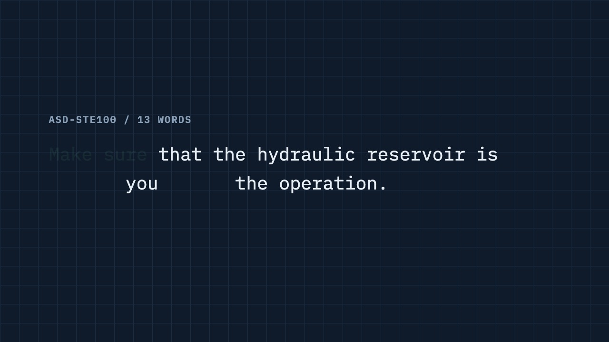

# explain-ladder

Explain any topic with Karpathy's ladder: text → diagram → web page → video.

[繁體中文](README.zh-TW.md)



## Install

```sh
npx skills add Ray0907/explain-ladder -g
```

Select Claude Code, pi, or another supported agent. Install browser dependencies
once in the installed skill directory (normally `~/.agents/skills/explain`):

```sh
cd ~/.agents/skills/explain
pnpm install
```

## Usage

```text
/explain 1,4 how HTTP cache works
/explain 2,3 HTTP 快取
```

Choose any combination of formats. Without numbers, the skill asks for formats
and language. Format 1 is always English; formats 2–4 support Traditional Chinese
and English. Outputs go to `~/Documents/explainers/<topic-slug>/` by default;
set `EXPLAIN_OUT` to change the base directory.

| Format | Output | Check |
|---|---|---|
| 1 · Text | ASD-STE100-style Simplified Technical English + checker | `ste-check` exit 0 |
| 2 · Diagram | One-sheet inline SVG/HTML diagram | Light/dark screenshots, 390px, no overflow |
| 3 · Web page | Interactive controls and live explanation | Core logic samples + browser checks |
| 4 · Video | Narrated HTML animation, MP4 + poster | ffprobe streams/duration OK + frame review |

The text checker covers selected rules; it is not full ASD-STE100 certification.
Formats 2–3 publish as Artifacts when tools are available. Otherwise, they save
local HTML and report publishing as pending.

## Requirements

- Node >= 22; pnpm for dependencies.
- Google Chrome (driven by `playwright-core` for screenshots and video).
- Video: `ffmpeg` with `ffprobe` and a narration engine.
- Default voice order: ElevenLabs when `ELEVENLABS_API_KEY` is set → free local
  Kokoro via `uv` → macOS `say`. Kokoro supports Mandarin and English; `uv` runs
  isolated Python 3.12 dependencies without a global install.
- Kokoro's first run needs internet access and about 721 MB for both languages;
  later runs reuse `${XDG_CACHE_HOME:-$HOME/.cache}/explain-kokoro/`.
- `EXPLAIN_TTS=elevenlabs|kokoro|say` forces one engine (failure stops the run).
  `ELEVENLABS_VOICE_ID` selects the ElevenLabs voice.
- AskUserQuestion/Artifact tools are optional: other agents ask in plain text and
  save local HTML instead of publishing.

## Develop

The skill lives in `explain/`; `examples/` stays at repo root and is not installed.

```sh
pnpm --dir explain install
node explain/scripts/ste-check.test.mjs
node explain/scripts/checker.test.mjs
node explain/scripts/make-video.test.mjs
```

The voice fallback smoke test needs macOS `say`. After editing the repo, re-run
the same local install command to refresh the installed copy:

```sh
npx -y skills add /Users/ray/Documents/explain-ladder -g -a claude-code -a pi -y
pnpm --dir ~/.agents/skills/explain install
```

Replace the checkout path if yours differs. The canonical installed copy is
`~/.agents/skills/explain`; Claude Code and pi point to it through symlinks.

## Credits

- The ladder idea comes from [Andrej Karpathy's post on reading LLM output](https://x.com/karpathy/status/2105819303471976479).
- ASD-STE100 is a trademark and specification of ASD. See
  [asd-ste100.org](https://asd-ste100.org/). This project is independent of ASD.
- Local narration uses [Kokoro ONNX](https://github.com/thewh1teagle/kokoro-onnx)
  (MIT); the Kokoro model is Apache-2.0 licensed and downloaded separately.

## License

[MIT](LICENSE) · Copyright (c) 2026 Ray Tien.
